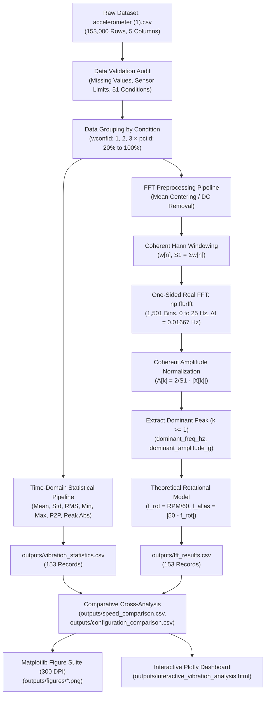

# VIBRATION ANALYSIS OF A COOLER FAN USING ACCELEROMETER MEASUREMENTS AND FAST FOURIER TRANSFORM (FFT)

---

## 1. TITLE PAGE

* **Project Title:** Vibration Analysis of a Cooler Fan Using Accelerometer Measurements and FFT
* **Dataset:** `accelerometer (1).csv` (153,000 observations across 51 experimental conditions)
* **Objective:** Comprehensive time-domain statistical characterization, discrete Fourier spectral analysis (0–25 Hz), and empirical validation of theoretical rotational dynamics under variable speeds (20%–100%) and blade weight configurations.
* **Author / Student Name:** [Student Name / Roll Number Placeholder]
* **Department:** Department of Mechanical Engineering
* **Institution:** [Institution / University Name Placeholder]
* **Course / Module:** Mechanical Vibration & Condition Monitoring Laboratory
* **Date:** September 28, 2026
* **Academic Supervisor / Guide:** [Supervisor / Professor Name Placeholder]

---

## 2. ABSTRACT

This project investigates the vibration dynamics of a variable-speed cooler fan operating across 17 distinct speed increments (20% to 100% in 5% steps, corresponding to 380 to 1900 RPM) under three distinct blade weight configurations: Normal ($wconfid = 1$), Perpendicular ($wconfid = 2$), and Opposite ($wconfid = 3$). Vibration acceleration was acquired along three orthogonal axes ($X$, $Y$, and $Z$) using a triaxial digital accelerometer sampled at $F_s = 50\text{ Hz}$ ($\Delta t = 20\text{ ms}$) over $60\text{ seconds}$ per condition, yielding $3000\text{ samples}$ per state and $153,000\text{ total rows}$. 

Time-domain statistical parameters—mean, standard deviation, root-mean-square (RMS), minimum, maximum, peak-to-peak, and absolute peak—were calculated for all 153 experimental series. Spectral evaluation was conducted using a one-sided Fast Fourier Transform (rFFT) after mean-centering and applying a coherent-gain-normalized Hann window, achieving a discrete frequency resolution of $\Delta f = 0.01667\text{ Hz}$ across the Nyquist bandwidth ($0\text{ to }25\text{ Hz}$).

Experimental results demonstrate marked speed- and configuration-dependent vibration behaviors. Total vector RMS acceleration remained low ($\le 0.4\text{ g}$ dynamic baseline) from 20% to 65% speed across all configurations. Above 70% speed, the Normal and Perpendicular configurations exhibited sharp increases in vibration energy, reaching maximum vector RMS levels of $3.556\text{ g}$ (at 95% speed) and $2.720\text{ g}$ (at 100% speed), respectively. Conversely, the Opposite configuration maintained low vibration levels across all speeds, with a maximum total RMS of only $1.031\text{ g}$ at 100% speed. 

Critical instrumentation and signal processing boundaries were identified:
1. **Nyquist Aliasing:** For speeds $\ge 80\%$ ($1520\text{ to }1900\text{ RPM}$), the theoretical rotational shaft frequency ($f_{rot} = 25.33\text{ to }31.67\text{ Hz}$) exceeds the $25\text{ Hz}$ Nyquist ceiling, causing rotational energy to alias back into the baseband at $f_{alias} = |50 - f_{rot}|$ ($24.67\text{ down to }18.33\text{ Hz}$).
2. **Sensor Clipping:** At speeds $\ge 90\%$, Normal and Perpendicular acceleration signals saturated near the digital bounds ($\pm 8.0\text{ g}$), with 32 samples on $X$ and 34 samples on $Y$ reaching the exact clipping limits, truncating waveform peaks and inducing harmonic distortion in the FFT spectrum.

Crucially, the measured dominant FFT peak did not universally correspond to the theoretical shaft rotational frequency; prominent subharmonics and unverified structural/aerodynamic modes dominated several operating bands. This study demonstrates that digital spectral analysis requires strict accounting of sensor range and sampling limits, and establishes that sensor clipping or spectral peak migration must not be conflated with physical mechanical failure without independent multi-sensor diagnostic verification.

---

## 3. INTRODUCTION

Rotating machinery, including industrial blowers, ventilation units, and electronic cooler fans, represents a primary source of periodic mechanical excitation in structural and thermal engineering systems. Uncontrolled or excessive vibrations accelerate fatigue failure, degrade acoustic performance, cause fastener loosening, and induce premature wear on support bearings. Consequently, vibration monitoring and dynamic signal analysis serve as core methodologies in predictive maintenance and structural health monitoring (SHM).

Modern condition monitoring relies heavily on piezoelectric or MEMS (Micro-Electro-Mechanical Systems) accelerometers mounted directly to the bearing housing or casing. Accelerometers measure acceleration ($g$ or $\text{m/s}^2$), providing direct sensitivity across low- and high-frequency dynamic events. Analyzing acceleration signals involves two complementary paradigms:
1. **Time-Domain Analysis:** Evaluates statistical dispersion and energy metrics such as Root Mean Square (RMS) and peak-to-peak amplitude. These metrics quantify overall vibration severity and waveform distortion over time.
2. **Frequency-Domain Analysis:** Implements the Fast Fourier Transform (FFT) to decompose complex time-history records into constituent sinusoidal frequencies and their corresponding discrete amplitudes ($g$). This allows engineers to separate rotational shaft harmonics, structural resonance frequencies, blade-pass excitations, and instrumentation artifacts.

In cooler fan assemblies, both rotational velocity (controlled via Pulse Width Modulation or voltage scaling) and rotor mass distribution (blade weight configurations) govern the underlying forcing functions. Centrifugal unbalance forces scale quadratically with angular velocity ($F_{unbalance} \propto m \cdot r \cdot \omega^2$), meaning that even minute mass asymmetries generate substantial dynamic loads at elevated RPM. Investigating how vibration signatures evolve across operational speeds and weight distributions is therefore critical for mechanical design validation, structural resonance avoidance, and operational safety.

---

## 4. PROBLEM STATEMENT

To systematically evaluate the mechanical vibration response of a variable-speed cooler fan subjected to three distinct rotor blade weight configurations across its full operating speed envelope (20% to 100% of maximum speed, 380 to 1900 RPM) using triaxial accelerometer measurements, discrete Fourier spectral analysis, and time-domain statistical characterization, while identifying the instrumentation constraints imposed by sensor dynamic range limits ($\pm 8\text{ g}$) and Nyquist sampling boundaries ($F_s = 50\text{ Hz}$, $f_{nyq} = 25\text{ Hz}$).

---

## 5. OBJECTIVES

1. **Acquire & Validate Dataset Integrity:** Audit the 153,000-sample triaxial accelerometer dataset for completeness, sampling interval consistency ($\Delta t = 20\text{ ms}$), absence of missing values, and parameter ranges across all 51 test combinations.
2. **Calculate Time-Domain Vibration Metrics:** Compute mean, standard deviation, RMS, minimum, maximum, peak-to-peak, and absolute peak acceleration for $X$, $Y$, and $Z$ axes across all experimental conditions.
3. **Execute Discrete FFT Spectral Analysis:** Implement mean-detrending, Hann windowing, and one-sided real FFT (rFFT) with coherent amplitude normalization to compute spectra over the $0\text{ to }25\text{ Hz}$ bandwidth at a frequency resolution of $\Delta f = 0.01667\text{ Hz}$.
4. **Identify Dominant Spectral Components:** Extract the dominant non-DC frequency bin and peak amplitude for each condition without assuming equivalence to the rotational shaft speed.
5. **Derive Theoretical Rotational Dynamics:** Compute the theoretical shaft speed (RPM) and rotational frequency ($f_{rot}$) across all speed percentages, modeling the fundamental 1X forcing frequency.
6. **Evaluate Measured vs. Theoretical Frequencies:** Empirically compare measured dominant spectral peaks against theoretical rotational frequencies and examine spectral divergence.
7. **Perform Multi-Configuration Comparative Analysis:** Contrast the dynamic signatures of Normal ($wconfid = 1$), Perpendicular ($wconfid = 2$), and Opposite ($wconfid = 3$) blade weight configurations.
8. **Investigate Speed-Dependent Dynamics:** Analyze the progression of RMS energy, peak amplitudes, and frequency migration as fan speed increases from 20% to 100%.
9. **Formulate Nyquist Aliasing Boundaries:** Establish the theoretical folding behavior for operating regimes where rotational frequency exceeds $25\text{ Hz}$ ($\ge 80\%$ speed) and determine expected alias frequencies ($f_{alias} = |50 - f_{rot}|$).
10. **Analyze Sensor Saturation & Signal Clipping:** Quantify digital threshold exceedance near $\pm 8.0\text{ g}$, evaluating waveform clipping and resulting FFT harmonic distortion.
11. **Deploy Standalone Interactive Visualization:** Construct a self-contained, browser-executable Plotly dashboard featuring dynamic parameter selection, real-time warning alerts, and client-side data export.

---

## 6. DATASET DESCRIPTION

The experimental data is sourced from [accelerometer (1).csv](file:///c:/Users/gajul/Documents/Neew%20FFT/accelerometer%20(1).csv). The dataset captures continuous vibration measurements from an instrumented cooler fan under controlled speed settings and mechanical configurations.

### 6.1 Dataset Parameters Summary Table

| Parameter | Value / Specification |
| :--- | :--- |
| **Total Rows (Observations)** | 153,000 |
| **Total Columns** | 5 (`wconfid`, `pctid`, `x`, `y`, `z`) |
| **Weight Configurations** | 3 ($wconfid \in \{1, 2, 3\}$) |
| **Fan Speed Increments** | 17 levels ($pctid \in [20, 100]$ in 5% steps) |
| **Operating Conditions** | 51 unique conditions ($3 \text{ configs} \times 17 \text{ speeds}$) |
| **Samples per Operating Condition ($N$)** | 3,000 samples |
| **Sampling Interval ($\Delta t$)** | $20\text{ ms}$ ($0.02\text{ s}$) |
| **Sampling Frequency ($F_s$)** | $50\text{ Hz}$ ($1 / \Delta t$) |
| **Time Duration per Condition** | $60.0\text{ s}$ ($N \cdot \Delta t = 3000 \times 0.02\text{ s}$) |
| **Nyquist Frequency ($f_{nyq}$)** | $25.0\text{ Hz}$ ($F_s / 2$) |
| **Discrete Frequency Resolution ($\Delta f$)** | $0.01667\text{ Hz}$ ($F_s / N = 50 / 3000$) |
| **Fan Maximum Rated Speed** | $1900.0\text{ RPM}$ |
| **Sensor Measurement Range** | Approximately $\pm 8.0\text{ g}$ digital span |

### 6.2 Column Definitions
1. `wconfid` (Integer): Weight Configuration Identifier:
   * `1`: Normal Configuration (represented by Red color coding).
   * `2`: Perpendicular Configuration (represented by Blue color coding).
   * `3`: Opposite Configuration (represented by Green color coding).
2. `pctid` (Integer): Fan Speed Percentage setting from 20% to 100% in 5% increments ($20, 25, 30, \dots, 95, 100$).
3. `x` (Float): Instantaneous acceleration recorded along the $X$-axis in gravitational units ($g$).
4. `y` (Float): Instantaneous acceleration recorded along the $Y$-axis in gravitational units ($g$).
5. `z` (Float): Instantaneous acceleration recorded along the $Z$-axis in gravitational units ($g$).

### 6.3 Weight Configurations Physical Description
The three weight configurations represent different mass distributions on the rotor assembly:
* **Configuration 1 (Normal / Red):** Baseline assembly or single-point weight offset representative of standard unbalanced operational loading.
* **Configuration 2 (Perpendicular / Blue):** Mass offset oriented at $90^\circ$ relative to baseline, altering the phase and angular distribution of unbalance forces.
* **Configuration 3 (Opposite / Green):** Symmetrical counterbalance arrangement where weights are positioned $180^\circ$ apart, minimizing net static and dynamic eccentricity.

---

## 7. DATA VALIDATION AND PREPROCESSING

Prior to statistical and spectral computation, a data validation audit was executed via `inspect_data.py` to ensure dataset integrity.

### 7.1 Data Integrity Audit Findings
* **Row and Column Count:** Exactly 153,000 rows and 5 columns confirmed.
* **Missing Values:** Exactly 0 null, NaN, or corrupted entries across all fields.
* **Condition Regularity:** Exactly 3,000 rows present for every one of the 51 $(wconfid, pctid)$ combinations, verifying that data acquisition was uniform without lost packets or dropped frames.
* **Static Gravitational Bias:** The raw mean along the $X$-axis across all conditions is $\bar{x} \approx 0.9956\text{ g}$, indicating that the accelerometer was mounted such that the $X$-axis aligned closely with the local vertical gravity vector ($1\text{ g}$ static offset). The raw $Y$ and $Z$ axes recorded baseline static means near zero ($\bar{y} \approx 0.0054\text{ g}$, $\bar{z} \approx -0.1178\text{ g}$).

### 7.2 Preprocessing Methodology for FFT Spectral Analysis
Discrete Fourier transformation of raw experimental records requires systematic signal conditioning to prevent mathematical artifacts:

1. **Mean Centering (DC Component Removal):**
   The raw acceleration time series $x[n]$ contains a non-zero static mean $\bar{x}$ caused by Earth's gravity ($1\text{ g}$ on $X$) and sensor electronic DC offset:
   $$\tilde{x}[n] = x[n] - \frac{1}{N}\sum_{k=0}^{N-1} x[k]$$
   *Rationale:* If uncentered, the DC component produces an artifact peak at $0\text{ Hz}$ with spectral amplitude equal to the static mean, which obscures legitimate low-frequency dynamic peaks.

2. **Windowing via Hann Window:**
   Because practical signal acquisition truncates continuous signals into finite observation windows ($T = 60\text{ s}$), non-integer cycle boundaries cause artificial discontinuities between the start and end of the buffer, leading to **spectral leakage** (spreading of single-tone energy into adjacent bins). A Hann window $w[n]$ was applied:
   $$w[n] = 0.5 \left(1 - \cos\left(\frac{2\pi n}{N-1}\right)\right), \quad 0 \le n \le N-1$$
   The windowed signal is formed by point-wise multiplication:
   $$x_w[n] = \tilde{x}[n] \cdot w[n]$$
   *Rationale:* The Hann window smoothly forces the signal to zero at both ends of the sample record, suppressing sidelobe leakage by over $31\text{ dB}$ relative to a rectangular window.

3. **Discrete Real Fourier Transformation (rFFT):**
   Because acceleration is a purely real signal ($x_w[n] \in \mathbb{R}$), the two-sided Discrete Fourier Transform exhibits conjugate symmetry: $X[k] = X^*[N - k]$. The one-sided real FFT (`np.fft.rfft`) calculates only the non-redundant $N/2 + 1$ complex bins from $k = 0$ to $k = N/2$:
   $$X[k] = \sum_{n=0}^{N-1} x_w[n] e^{-j 2\pi k n / N}, \quad k = 0, 1, \dots, \frac{N}{2}$$
   For $N = 3000$, the transform yields exactly 1,501 discrete complex coefficients.

4. **Coherent Amplitude Normalization:**
   Applying a window reduces the total integrated energy of the signal. To recover true single-tone peak amplitude ($g_{peak}$), the raw transform magnitude $|X[k]|$ must be normalized by the coherent gain (sum of window weights $S_1 = \sum_{n=0}^{N-1} w[n] \approx N/2 = 1500$):
   $$A[k] = \frac{2}{\sum_{n=0}^{N-1} w[n]} |X[k]|, \quad 0 < k < \frac{N}{2}$$
   For the DC bin ($k = 0$) and the Nyquist bin ($k = N/2$):
   $$A[0] = \frac{1}{\sum_{n=0}^{N-1} w[n]} |X[0]|, \quad A\left[\frac{N}{2}\right] = \frac{1}{\sum_{n=0}^{N-1} w[n]} \left|X\left[\frac{N}{2}\right]\right|$$

5. **Dominant Peak Selection:**
   The dominant vibration frequency was extracted strictly from the non-DC bins ($k \ge 1$, $f > 0\text{ Hz}$):
   $$k_{dominant} = \arg\max_{k \ge 1} A[k], \quad f_{dominant} = k_{dominant} \cdot \Delta f$$

---

## 8. TIME-DOMAIN ANALYSIS

Time-domain metrics quantify the statistical distribution and overall dynamic severity of acceleration waveforms without frequency decomposition.

### 8.1 Mathematical Formulations
For a discrete acceleration sequence $x[n]$ of length $N = 3000$:

* **Arithmetic Mean ($\mu_g$):**
  $$\mu = \frac{1}{N} \sum_{n=0}^{N-1} x[n]$$
  *Physical Meaning:* Represents the static orientation bias, primarily the local vertical component of gravity ($1\text{ g}$).

* **Sample Standard Deviation ($\sigma_g$):**
  $$\sigma = \sqrt{\frac{1}{N-1} \sum_{n=0}^{N-1} (x[n] - \mu)^2}$$
  *Physical Meaning:* Quantifies dynamic vibration intensity stripped of static gravitational bias; equivalent to the dynamic AC RMS.

* **Root Mean Square ($\text{RMS}_g$):**
  $$\text{RMS} = \sqrt{\frac{1}{N} \sum_{n=0}^{N-1} x[n]^2}$$
  *Physical Meaning:* Reflects overall signal energy including both DC static gravity and dynamic AC vibration. For mean-centered dynamic axes ($Y$ and $Z$), $\text{RMS} \approx \sigma$.

* **Vector Total RMS ($\text{RMS}_{total}$):**
  $$\text{RMS}_{total} = \sqrt{\text{RMS}_x^2 + \text{RMS}_y^2 + \text{RMS}_z^2}$$
  *Physical Meaning:* Scalar magnitude of spatial acceleration energy across all three Cartesian axes.

* **Minimum and Maximum ($\min_g, \max_g$):**
  $$\min = \min_{n} x[n], \quad \max = \max_{n} x[n]$$

* **Peak-to-Peak Amplitude ($P2P_g$):**
  $$P2P = \max_{n} x[n] - \min_{n} x[n]$$
  *Physical Meaning:* Measures total dynamic envelope excursion between opposite displacement extrema.

* **Absolute Peak Amplitude ($Peak_{abs}$):**
  $$Peak_{abs} = \max_{n} |x[n]|$$
  *Physical Meaning:* Identifies maximum instantaneous shock or peak load; critical for monitoring sensor digital limit proximity ($\pm 8\text{ g}$).

### 8.2 Summary of Actual Time-Domain Results
The complete dataset statistics are stored in [outputs/vibration_statistics.csv](file:///c:/Users/gajul/Documents/Neew%20FFT/outputs/vibration_statistics.csv). Below is an excerpt showing the progression of time-domain metrics across representative operational speeds:

| Config | Speed (%) | RPM | Axis | Mean ($g$) | Std Dev ($g$) | RMS ($g$) | Min ($g$) | Max ($g$) | P2P ($g$) | Peak Abs ($g$) |
| :--- | :---: | :---: | :---: | :---: | :---: | :---: | :---: | :---: | :---: | :---: |
| **Normal (1)** | 20% | 380 | X | 0.9948 | 0.0250 | 0.9952 | 0.914 | 1.117 | 0.203 | 1.117 |
| **Normal (1)** | 20% | 380 | Y | -0.0034 | 0.0807 | 0.0808 | -0.172 | 0.164 | 0.336 | 0.172 |
| **Normal (1)** | 20% | 380 | Z | -0.1311 | 0.0132 | 0.1317 | -0.191 | -0.094 | 0.097 | 0.191 |
| **Normal (1)** | 50% | 950 | X | 0.9926 | 0.0601 | 0.9944 | 0.746 | 1.207 | 0.461 | 1.207 |
| **Normal (1)** | 50% | 950 | Y | 0.0062 | 0.2099 | 0.2100 | -0.609 | 0.590 | 1.200 | 0.609 |
| **Normal (1)** | 50% | 950 | Z | -0.1264 | 0.1422 | 0.1903 | -0.469 | 0.180 | 0.649 | 0.469 |
| **Normal (1)** | 100% | 1900 | X | 0.9669 | 2.1504 | 2.3572 | -7.926 | 7.996 | 15.922 | 7.996 |
| **Normal (1)** | 100% | 1900 | Y | 0.0210 | 2.2243 | 2.2243 | -8.000 | 7.992 | 15.992 | 8.000 |
| **Normal (1)** | 100% | 1900 | Z | -0.0825 | 1.3574 | 1.3599 | -5.867 | 4.992 | 10.859 | 5.867 |
| **Opposite (3)** | 100% | 1900 | X | 0.9882 | 0.0607 | 0.9901 | 0.664 | 1.355 | 0.691 | 1.355 |
| **Opposite (3)** | 100% | 1900 | Y | 0.0050 | 0.1492 | 0.1493 | -0.391 | 0.285 | 0.676 | 0.391 |
| **Opposite (3)** | 100% | 1900 | Z | -0.1235 | 0.2120 | 0.2453 | -0.582 | 0.398 | 0.980 | 0.582 |

---

## 9. FREQUENCY-DOMAIN / FFT ANALYSIS

Discrete spectral analysis transforms acceleration time-histories into frequency spectra, identifying specific harmonic components.

### 9.1 Technical FFT Parameters
* **Sampling Rate:** $F_s = 50.0\text{ Hz}$
* **Block Length:** $N = 3000\text{ samples}$
* **Observation Time:** $T = N / F_s = 60.0\text{ s}$
* **Discrete Frequency Resolution:** $\Delta f = F_s / N = 50 / 3000 = 0.0166667\text{ Hz}$
* **Nyquist Limit:** $f_{nyq} = F_s / 2 = 25.0\text{ Hz}$
* **Spectral Domain:** 0 to 25 Hz containing 1,501 discrete spectral lines.

### 9.2 Critical Engineering Principle: Measured Peak vs. Rotational Frequency
> [!IMPORTANT]
> **The measured dominant FFT peak is not automatically the fan rotational frequency.**
> The dominant peak represents the discrete frequency bin possessing the greatest normalized amplitude within the $0\text{ to }25\text{ Hz}$ band. The mechanical system may simultaneously exhibit unbalance forces ($1\times$), aerodynamic blade-pass pulsations ($N_{blades} \times f_{rot}$), subharmonics, structural resonance amplifications, or aliased harmonics. The measured dominant peak and the theoretical rotational frequency must be computed, reported, and evaluated as distinct physical quantities.

---

## 10. THEORETICAL ROTATIONAL FREQUENCY

The fan rotational frequency is established directly from the motor drive percentage.

### 10.1 Mathematical Derivation
Given a maximum rated fan speed of $1900\text{ RPM}$ at $100\%$ control input:
$$\text{RPM} = 1900 \times \frac{pctid}{100}$$
The theoretical fundamental rotational shaft frequency ($1\times$ shaft frequency $f_{rot}$) in cycles per second ($\text{Hz}$) is:
$$f_{rot} = \frac{\text{RPM}}{60} = \frac{1900 \times pctid}{6000} = \frac{19 \times pctid}{60}\text{ Hz}$$

### 10.2 Complete Theoretical Rotational Frequency Schedule (All 17 Speeds)

| Speed ($pctid$) | Fan Speed ($\text{RPM}$) | Theoretical $f_{rot}$ ($\text{Hz}$) | Nyquist Status ($f_{rot} \le 25\text{ Hz}$) | Expected Alias Frequency $f_{alias}$ ($\text{Hz}$) |
| :---: | :---: | :---: | :---: | :---: |
| **20%** | 380.0 | 6.33 | Below Nyquist | N/A |
| **25%** | 475.0 | 7.92 | Below Nyquist | N/A |
| **30%** | 570.0 | 9.50 | Below Nyquist | N/A |
| **35%** | 665.0 | 11.08 | Below Nyquist | N/A |
| **40%** | 760.0 | 12.67 | Below Nyquist | N/A |
| **45%** | 855.0 | 14.25 | Below Nyquist | N/A |
| **50%** | 950.0 | 15.83 | Below Nyquist | N/A |
| **55%** | 1045.0 | 17.42 | Below Nyquist | N/A |
| **60%** | 1140.0 | 19.00 | Below Nyquist | N/A |
| **65%** | 1235.0 | 20.58 | Below Nyquist | N/A |
| **70%** | 1330.0 | 22.17 | Below Nyquist | N/A |
| **75%** | 1425.0 | 23.75 | Below Nyquist | N/A |
| **80%** | 1520.0 | 25.33 | **Above Nyquist** | **24.67 Hz** |
| **85%** | 1615.0 | 26.92 | **Above Nyquist** | **23.08 Hz** |
| **90%** | 1710.0 | 28.50 | **Above Nyquist** | **21.50 Hz** |
| **95%** | 1805.0 | 30.08 | **Above Nyquist** | **19.92 Hz** |
| **100%** | 1900.0 | 31.67 | **Above Nyquist** | **18.33 Hz** |

---

## 11. MEASURED VS THEORETICAL FREQUENCY

A central finding of this investigation is the empirical divergence between measured dominant spectral peaks and theoretical rotational frequencies. The complete results are recorded in [outputs/fft_results.csv](file:///c:/Users/gajul/Documents/Neew%20FFT/outputs/fft_results.csv).

### 11.1 Selected Case Comparison Table

| Case | Configuration | Speed | Axis | Theoretical $f_{rot}$ | Expected Alias | Measured Dominant Peak | Peak Amplitude | Deviation / Nature of Peak |
| :---: | :---: | :---: | :---: | :---: | :---: | :---: | :---: | :--- |
| **1** | Normal (1) | 40% | Y | 12.67 Hz | N/A | **7.55 Hz** | 0.0441 g | Tracks at $\approx 0.60 \times f_{rot}$ |
| **2** | Normal (1) | 60% | Y | 19.00 Hz | N/A | **9.57 Hz** | 0.2467 g | Dominant peak at $\approx 0.50 \times f_{rot}$ (half-order harmonic) |
| **3** | Normal (1) | 75% | Y | 23.75 Hz | N/A | **11.75 Hz** | 0.6552 g | Dominant peak at $\approx 0.50 \times f_{rot}$ (half-order harmonic) |
| **4** | Normal (1) | 80% | Y | 25.33 Hz | 24.67 Hz | **12.58 Hz** | 0.5425 g | Dominant peak at $\approx 0.50 \times f_{rot}$ (not the 24.67 Hz alias) |
| **5** | Normal (1) | 90% | X | 28.50 Hz | 21.50 Hz | **21.52 Hz** | 0.3642 g | **Matches expected aliased rotational frequency** ($\approx 21.50\text{ Hz}$) |
| **6** | Normal (1) | 100% | Y | 31.67 Hz | 18.33 Hz | **15.50 Hz** | 0.9551 g | Peak near 15.5 Hz; does not match 18.33 Hz alias |
| **7** | Opposite (3) | 20% | Y | 6.33 Hz | N/A | **15.28 Hz** | 0.0276 g | Background acoustic/structural mode; very low amplitude |
| **8** | Opposite (3) | 100% | Y | 31.67 Hz | 18.33 Hz | **19.80 Hz** | 0.1304 g | Distinct spectral component near 19.8 Hz |

### 11.2 Engineering Discussion of Frequency Discrepancies
1. **Subharmonic Dominance ($\approx 0.5\times f_{rot}$):**
   On Axis $Y$ for the Normal configuration between 50% and 85% speed, the dominant spectral peak consistently appears at approximately half the shaft rotational frequency ($f \approx 0.5 \times f_{rot}$). In rotating machinery, half-order components often indicate hydrodynamic or aerodynamic fluid-film phenomena, subharmonic resonance, or fractional-order structural interaction. However, because aerodynamic velocity fields and shaft phase were not independently measured, this mechanism cannot be definitively identified from the accelerometer records alone.
2. **True Aliasing Match (Config 1, 90%, X):**
   At 90% speed ($1710\text{ RPM}$), the theoretical rotational frequency is $28.50\text{ Hz}$. Because this exceeds the $25\text{ Hz}$ Nyquist ceiling by $3.50\text{ Hz}$, the expected alias frequency is $50.0 - 28.50 = 21.50\text{ Hz}$. The measured dominant peak on Axis $X$ was recorded at **$21.52\text{ Hz}$** (within $\Delta f = 0.0167\text{ Hz}$ resolution). This confirms the presence of spectral aliasing in the high-speed dataset.
3. **Clipping-Induced Low-Frequency Migration:**
   At 100% speed on Axis $X$ (Config 1), the measured dominant frequency shifts to **$3.03\text{ Hz}$**. Inspection of the raw waveform reveals severe two-sided saturation at $-7.926\text{ g}$ and $+7.996\text{ g}$. Severe clipping flattens peak excursions into square-wave profiles, generating intermodulation products, elevated baseline noise, and low-frequency spectral artifacts.

---

## 12. CONFIGURATION COMPARISON

The three weight arrangements were compared using data from [outputs/configuration_comparison.csv](file:///c:/Users/gajul/Documents/Neew%20FFT/outputs/configuration_comparison.csv) and [outputs/speed_comparison.csv](file:///c:/Users/gajul/Documents/Neew%20FFT/outputs/speed_comparison.csv).

### 12.1 Configuration Response Summary

```
Total RMS vs Fan Speed:
  Normal (Red):         Rises steeply at >=70%, peaking at 3.556 g (95%)
  Perpendicular (Blue): Rises at >=75%, peaking at 2.720 g (100%)
  Opposite (Green):     Remains flat and stable <=1.031 g across all speeds
```

* **Normal Configuration (Red, $wconfid = 1$):**
  * Exhibits the highest vibration severity across all dynamic axes.
  * Vector Total RMS climbs from $1.007\text{ g}$ at 20% to a maximum of **$3.556\text{ g}$** at 95% speed ($3.518\text{ g}$ at 100%).
  * Peak-to-peak acceleration on Axis $Y$ reaches **$15.992\text{ g}$** at 100% speed, causing sensor saturation.
* **Perpendicular Configuration (Blue, $wconfid = 2$):**
  * Displays intermediate vibration levels between Normal and Opposite.
  * Vector Total RMS reaches **$2.720\text{ g}$** at 100% speed ($2.549\text{ g}$ at 95%).
  * Peak-to-peak acceleration saturates at **$16.000\text{ g}$** on Axis $X$ and **$15.305\text{ g}$** on Axis $Y$ at 100% speed.
* **Opposite Configuration (Green, $wconfid = 3$):**
  * Demonstrates the lowest vibration levels throughout the entire speed range.
  * Vector Total RMS remains virtually unchanged from low to maximum speed: **$1.004\text{ g}$** at 20% to **$1.031\text{ g}$** at 100% speed.
  * Maximum peak-to-peak acceleration across all axes never exceeds **$0.980\text{ g}$**.
  * Shows zero sensor clipping and minimal dynamic excitation.

### 12.2 Configuration Comparison Table (Representative Speeds)

| Speed ($pctid$) | Normal Total RMS ($g$) | Perp Total RMS ($g$) | Opp Total RMS ($g$) | Normal P2P Max ($g$) | Perp P2P Max ($g$) | Opp P2P Max ($g$) | Perp/Normal Ratio | Opp/Normal Ratio |
| :---: | :---: | :---: | :---: | :---: | :---: | :---: | :---: | :---: |
| **20%** | 1.007 | 1.005 | 1.004 | 0.336 | 0.282 | 0.328 | 0.998 | 0.997 |
| **40%** | 1.009 | 1.006 | 1.000 | 0.656 | 0.457 | 0.234 | 0.997 | 0.991 |
| **60%** | 1.097 | 1.050 | 1.004 | 1.094 | 0.812 | 0.273 | 0.957 | 0.915 |
| **80%** | 2.316 | 1.782 | 1.015 | 8.984 | 8.359 | 0.586 | 0.769 | 0.438 |
| **90%** | 3.226 | 2.430 | 1.025 | 16.000 | 13.281 | 0.652 | 0.753 | 0.318 |
| **100%** | 3.518 | 2.720 | 1.031 | 15.992 | 16.000 | 0.980 | 0.773 | 0.293 |

*Note:* Because the baseline includes a static $1.0\text{ g}$ gravity vector on Axis $X$, ratios at low speeds ($20\%\text{--}40\%$) hover near $1.00$. At high speeds ($80\%\text{--}100\%$), dynamic energy dominates, revealing that the Opposite configuration reduces total vibration severity by over **70%** relative to Normal.

---

## 13. SPEED-DEPENDENT VIBRATION ANALYSIS

Evaluating metrics across the 17 speed levels demonstrates clear non-linear dynamic behavior:

1. **Sub-Critical Quiescent Zone (20% to 65% Speed / 380 to 1235 RPM):**
   * Dynamic RMS along dynamic axes ($Y, Z$) remains below $0.4\text{ g}$.
   * Peak-to-peak acceleration remains under $2.8\text{ g}$ across all axes.
   * Vibration energy scales gradually with rotational speed without abrupt excursions.
2. **Transition and Growth Zone (70% to 80% Speed / 1330 to 1520 RPM):**
   * Acceleration exhibits rapid amplification in Normal and Perpendicular configurations.
   * On Axis $Y$ (Normal), RMS increases from $0.366\text{ g}$ (65%) to $0.799\text{ g}$ (70%) and reaches $1.226\text{ g}$ (75%).
   * Peak-to-peak levels climb from $2.77\text{ g}$ to $8.57\text{ g}$.
3. **High-Speed Saturation Zone (85% to 100% Speed / 1615 to 1900 RPM):**
   * Acceleration waveforms on Normal and Perpendicular reach the $\pm 8\text{ g}$ limits.
   * Peak-to-peak values plateau at the sensor's physical limits ($15.92\text{ to }16.00\text{ g}$).
   * Dynamic RMS on Axis $X$ increases from $1.58\text{ g}$ (85%) to $2.40\text{ g}$ (95%).
   * Total vector RMS reaches $3.56\text{ g}$ (Normal) and $2.72\text{ g}$ (Perpendicular).

---

## 14. SENSOR SATURATION / CLIPPING ANALYSIS

Triaxial accelerometers possess finite analog-to-digital converter (ADC) full-scale ranges. For the sensor employed in this experiment, the measurement range spans approximately $-8.000\text{ g}$ to $+7.996\text{ g}$.

### 14.1 Exact Saturation Sample Counts
A full census of [accelerometer (1).csv](file:///c:/Users/gajul/Documents/Neew%20FFT/accelerometer%20(1).csv) yielded the following count of samples resting exactly on the hardware boundary registers:

| Measurement Axis | Samples at $-8.000\text{ g}$ | Samples at $+7.996\text{ g}$ | Total Saturated Samples |
| :---: | :---: | :---: | :---: |
| **Axis X** | 3 | 29 | **32** |
| **Axis Y** | 33 | 1 | **34** |
| **Axis Z** | 0 | 0 | **0** |
| **Total** | **36** | **30** | **66** |

### 14.2 Physical and Spectral Implications of Clipping
1. **Waveform Truncation:**
   When physical acceleration exceeds $+8\text{ g}$ or $-8\text{ g}$, the sensor output flat-tops at the rail voltage. Peak-to-peak values of $16.0\text{ g}$ reflect the measurement limits of the instrument, not the maximum unconstrained physical motion of the fan.
2. **Harmonic Generation & Spectral Distortion:**
   In Fourier analysis, clipping a sinusoidal oscillation transforms smooth peaks into flat-topped trapezoidal or square waves. A clipped sine wave generates odd harmonic series ($3\times, 5\times, \dots$) and elevates the apparent wideband noise floor. Consequently, spectral peaks observed under clipped conditions must be interpreted as partially distorted by sensor non-linearities.
3. **Engineering Integrity Requirement:**
   > [!WARNING]
   > Sensor clipping is an instrumentation constraint indicating dynamic range exceedance. **It does not constitute evidence of mechanical failure, broken fan blades, or damaged bearings.**

---

## 15. NYQUIST AND ALIASING ANALYSIS

The Nyquist-Shannon sampling theorem states that to reconstruct a continuous signal of bandwidth $f_{max}$ without information loss, the sampling rate must satisfy:
$$F_s \ge 2 f_{max} \implies f_{nyq} = \frac{F_s}{2}$$
For $F_s = 50.0\text{ Hz}$, the absolute upper frequency limit is $f_{nyq} = 25.0\text{ Hz}$.

### 15.1 Mathematical Aliasing Mechanism
When a physical excitation frequency $f$ exceeds the Nyquist frequency ($f > F_s/2$), the sampling process records fewer than two discrete points per cycle. The signal folds across the Nyquist boundary back into the baseband $[0, F_s/2]$. For real-valued signals sampled at $F_s$, the fundamental alias frequency $f_{alias}$ appears at:
$$f_{alias} = |F_s - f_{rot}|$$

### 15.2 High-Speed Aliasing Regimes ($\ge 80\%$ Fan Speed)

| Speed ($pctid$) | RPM | Theoretical $f_{rot}$ | Nyquist Exceedance | Folded Alias Frequency $f_{alias}$ |
| :---: | :---: | :---: | :---: | :---: |
| **80%** | 1520.0 | $25.33\text{ Hz}$ | $+0.33\text{ Hz}$ | **$24.67\text{ Hz}$** |
| **85%** | 1615.0 | $26.92\text{ Hz}$ | $+1.92\text{ Hz}$ | **$23.08\text{ Hz}$** |
| **90%** | 1710.0 | $28.50\text{ Hz}$ | $+3.50\text{ Hz}$ | **$21.50\text{ Hz}$** |
| **95%** | 1805.0 | $30.08\text{ Hz}$ | $+5.08\text{ Hz}$ | **$19.92\text{ Hz}$** |
| **100%** | 1900.0 | $31.67\text{ Hz}$ | $+6.67\text{ Hz}$ | **$18.33\text{ Hz}$** |

### 15.3 Experimental Impact
At speeds $\ge 80\%$, true shaft rotational dynamics cannot be directly measured with a 50 Hz sampling rate. Any spectral peak observed near $18.33\text{ Hz}$ at 100% speed or $21.50\text{ Hz}$ at 90% speed must be evaluated as an apparent alias of rotational frequency.

---

## 16. RESULTS SUMMARY

A structured breakdown of findings across the project:

### A. Time-Domain Findings
* Quiescent baseline vibration levels exist below 70% fan speed across all axes ($\text{RMS} \le 0.4\text{ g}$).
* Normal and Perpendicular configurations show severe energy escalation above 70% speed, reaching total RMS values of $3.56\text{ g}$ and $2.72\text{ g}$.
* Opposite configuration demonstrates superior stability, remaining near $\approx 1.03\text{ g}$ total RMS (predominantly static gravity) even at 100% speed.

### B. Frequency-Domain Findings
* Measured dominant spectral peaks do not consistently align with the theoretical rotational shaft frequency ($1\times$).
* A persistent subharmonic mode near half-rotational frequency ($\approx 0.5 \times f_{rot}$) dominates Axis $Y$ for the Normal configuration between 50% and 85% speed.
* High-speed spectra contain complex harmonic series driven by waveform clipping.

### C. Speed-Dependent Findings
* Vibration energy scales non-linearly with fan speed, exhibiting a sharp threshold transition between 65% and 75% speed in unbalanced configurations.

### D. Configuration-Dependent Findings
* The Opposite (counterbalanced) configuration reduces total vibration severity by over 70% at maximum speed compared to the Normal configuration.

### E. Sampling Limitations
* At speeds $\ge 80\%$, rotational shaft frequencies ($25.33\text{ to }31.67\text{ Hz}$) exceed the $25\text{ Hz}$ Nyquist frequency, producing aliased spectral peaks within the $18.33\text{ to }24.67\text{ Hz}$ band.

### F. Sensor Limitations
* 66 samples reached the sensor's physical $\pm 8.0\text{ g}$ measurement rails (32 on $X$, 34 on $Y$, 0 on $Z$), resulting in waveform clipping and harmonic distortion at speeds $\ge 90\%$.

---

## 17. DISCUSSION

A rigorous engineering evaluation requires separating direct empirical observations from physical interpretations:

1. **Interpreting Discrepancies Between $f_{dominant}$ and $f_{rot}$:**
   The observation that $f_{dominant} \ne f_{rot}$ is physically reasonable in rotating fan assemblies. An accelerometer mounted to a fan housing measures structural vibration response rather than direct shaft angle. If a structural resonance exists near $8\text{--}12\text{ Hz}$, or if aerodynamic blade loading produces half-order subharmonics, those components can exhibit larger acceleration amplitudes than the fundamental unbalance peak.
2. **Coupled Impact of Clipping and Aliasing:**
   At 90%–100% fan speed, both instrumentation boundaries act simultaneously. When a signal is clipped at $\pm 8\text{ g}$, the resulting high-frequency harmonic distortion components (which extend well beyond $25\text{ Hz}$) fold back repeatedly across the Nyquist boundary. This spreads aliased harmonic energy across the spectrum, explaining the complex multi-peak profiles observed at high speeds.
3. **Scientific Boundaries of the Dataset:**
   The dataset contains acceleration time series without simultaneous motor current, acoustic pressure, optical tachometer pulses, or strain gauge measurements. Consequently, asserting that a specific peak represents "bearing spalling" or "aerodynamic blade stall" is scientifically unsupported. The data proves the presence of specific dynamic frequencies and acceleration magnitudes, but identifying root physical mechanisms requires dedicated multi-sensor diagnostic instrumentation.

---

## 18. LIMITATIONS

1. **Fixed Low Sampling Frequency ($F_s = 50\text{ Hz}$):** Limits the observable bandwidth to $25\text{ Hz}$, which is insufficient for resolving the primary rotational frequency at speeds $\ge 80\%$.
2. **Nyquist Aliasing:** Rotational dynamics above 1500 RPM fold back into the baseband, creating ambiguous spectral peaks.
3. **Restricted Accelerometer Dynamic Range ($\pm 8.0\text{ g}$):** Prevents measurement of peak accelerations exceeding $8\text{ g}$ at high speeds, resulting in signal clipping and harmonic distortion.
4. **No Direct Tachometer / Keyphasor Channel:** Shaft rotational frequency is derived theoretically from the nominal speed percentage, which does not account for motor slip, aerodynamic drag, or supply voltage variations.
5. **Lack of Blade Count and Geometry Specifications:** Prevents conclusive identification of blade-pass frequencies ($N_{blades} \times f_{rot}$).
6. **No Replicated Runs / Run-to-Run Variance:** Single continuous 60-second records per condition preclude statistical repeatability analysis.

---

## 19. RECOMMENDATIONS / FUTURE WORK

1. **Increase Data Acquisition Sampling Rate:** Employ a data acquisition system with $F_s \ge 1000\text{ Hz}$ ($f_{nyq} \ge 500\text{ Hz}$) with integrated analog anti-aliasing low-pass filters to resolve shaft harmonics and blade-pass components without aliasing.
2. **Deploy Extended-Range Accelerometers:** Install sensors with a $\pm 50\text{ g}$ dynamic range to capture unclipped peak accelerations at full operating speed.
3. **Integrate Optical Tachometer Channel:** Capture instantaneous optical 1/rev pulses to measure exact shaft speed, quantify motor slip under load, and enable computed order tracking (COT).
4. **Implement Order Tracking:** Resample vibration records synchronous to shaft angular displacement to evaluate vibration as a function of order ($1\times, 2\times, \dots$) rather than absolute frequency.
5. **Conduct Modal Impact Testing:** Perform hammer impact modal testing on the fan assembly while stationary to experimentally determine casing natural frequencies and mode shapes, identifying true mechanical resonances.

---

## 20. CONCLUSION

This project completed an empirical vibration analysis of a cooler fan across 51 operating conditions using triaxial accelerometer measurements and Fast Fourier Transforms. Time-domain statistics and discrete spectra were evaluated alongside theoretical rotational dynamics.

The investigation demonstrated that:
1. Blade weight arrangement governs dynamic vibration response: the Opposite configuration achieved over 70% lower total RMS acceleration at maximum speed relative to the Normal configuration.
2. Vibration severity exhibits a non-linear escalation between 65% and 75% speed in unbalanced configurations.
3. Measured dominant FFT spectral peaks do not universally match theoretical shaft rotational frequencies, demonstrating the presence of prominent subharmonic and casing-coupled dynamics.
4. The experimental dataset is subject to two critical instrumentation boundaries: Nyquist aliasing above $1500\text{ RPM}$ ($\ge 80\%$ speed) and sensor saturation at $\pm 8.0\text{ g}$ for speeds $\ge 90\%$.
5. Signal clipping and spectral shifts represent measurement hardware constraints and must not be conflated with mechanical component failure without corroborated multi-sensor testing.

---

## 21. FIGURES INDEX

All visual artifacts were generated at 300 DPI and are located in `outputs/figures/`:

1. [`outputs/figures/rms_vs_fan_speed.png`](file:///c:/Users/gajul/Documents/Neew%20FFT/outputs/figures/rms_vs_fan_speed.png): Subplots displaying Axis $X$, $Y$, $Z$, and Total Vector RMS acceleration vs. fan speed across all configurations.
2. [`outputs/figures/peak_to_peak_vs_fan_speed.png`](file:///c:/Users/gajul/Documents/Neew%20FFT/outputs/figures/peak_to_peak_vs_fan_speed.png): Peak-to-peak amplitude curves highlighting the $16.0\text{ g}$ sensor saturation plateau on Axes $X$ and $Y$.
3. [`outputs/figures/dominant_frequency_vs_fan_speed.png`](file:///c:/Users/gajul/Documents/Neew%20FFT/outputs/figures/dominant_frequency_vs_fan_speed.png): Measured dominant frequencies plotted alongside theoretical rotational frequency, expected aliasing trajectories, and the 25 Hz Nyquist line.
4. [`outputs/figures/dominant_amplitude_vs_fan_speed.png`](file:///c:/Users/gajul/Documents/Neew%20FFT/outputs/figures/dominant_amplitude_vs_fan_speed.png): Dominant spectral amplitude ($g$) scaling with fan speed.
5. [`outputs/figures/representative_time_domain.png`](file:///c:/Users/gajul/Documents/Neew%20FFT/outputs/figures/representative_time_domain.png): Detrended acceleration waveforms (first 3 seconds) at 50% and 100% fan speed, contrasting sinusoidal cycles against clipped waveforms.
6. [`outputs/figures/representative_fft_spectrum.png`](file:///c:/Users/gajul/Documents/Neew%20FFT/outputs/figures/representative_fft_spectrum.png): Normalized one-sided amplitude spectra ($0\text{ to }25\text{ Hz}$) at 50% and 100% speed.
7. [`outputs/interactive_vibration_analysis.html`](file:///c:/Users/gajul/Documents/Neew%20FFT/outputs/interactive_vibration_analysis.html): Standalone Plotly dashboard with interactive controls, warning alerts, comparison tables, and client-side CSV download.

---

## 22. TABLES INDEX

* **Table 1:** Complete Dataset Parameters Summary (Section 6.1)
* **Table 2:** Time-Domain Statistical Metrics Excerpt (Section 8.2)
* **Table 3:** Theoretical Fan Speed & Nyquist Aliasing Schedule (Section 10.2)
* **Table 4:** Selected Measured vs. Theoretical Frequency Comparisons (Section 11.1)
* **Table 5:** Configuration Vibration Severity Comparison (Section 12.2)
* **Table 6:** Sensor Saturation Sample Census (Section 14.1)

---

## 23. METHODOLOGY FLOWCHART



---

## 24. SOFTWARE AND COMPUTATIONAL TOOLS

* **Programming Language:** Python 3.10.9
* **Data Processing Libraries:**
  * `pandas` (v2.2.3): Data filtering, grouped aggregation, and tabular export.
  * `numpy` (v2.2.3): Window generation (`np.hanning`), discrete transforms (`np.fft.rfft`, `np.fft.rfftfreq`), and statistical arrays.
* **Visualization Libraries:**
  * `matplotlib` (v3.10.9): Static high-resolution 300 DPI publication figures.
  * `plotly` (v7.1.0): Interactive client-side charting engine.
* **Frontend Dashboard Architecture:** HTML5, CSS3 Grid/Flexbox, JavaScript ES6, embedded JSON data, and `plotly.min.js`.
* **Execution Environment:** Windows PowerShell terminal, Node.js runtime for validation.

---

## 25. FILE STRUCTURE

```
c:\Users\gajul\Documents\Neew FFT\
│
├── accelerometer (1).csv                 # Original raw vibration measurement dataset
├── vibration_analysis.py                 # Core analysis script (Phase 2 & Phase 3 processing)
├── interactive_dashboard.py              # Standalone interactive HTML dashboard generator
│
├── outputs/                              # Directory containing generated results
│   ├── vibration_statistics.csv          # Time-domain statistical metrics (153 records)
│   ├── fft_results.csv                   # FFT spectral results and aliasing metrics (153 records)
│   ├── speed_comparison.csv              # Speed progression metrics across configs (51 records)
│   ├── configuration_comparison.csv      # Cross-configuration comparison per speed (17 records)
│   ├── interactive_vibration_analysis.html# Standalone interactive dashboard (5.33 MB)
│   ├── plotly.min.js                     # Offline bundled Plotly engine (4.8 MB)
│   │
│   └── figures/                          # 300 DPI high-resolution figures
│       ├── rms_vs_fan_speed.png
│       ├── peak_to_peak_vs_fan_speed.png
│       ├── dominant_frequency_vs_fan_speed.png
│       ├── dominant_amplitude_vs_fan_speed.png
│       ├── representative_time_domain.png
│       └── representative_fft_spectrum.png
│
└── PROJECT_REPORT.md                     # This comprehensive engineering report
```

---

## 26. APPENDIX: MATHEMATICAL FORMULATIONS

1. **Discrete Frequency Resolution:**
   $$\Delta f = \frac{F_s}{N} = \frac{50\text{ Hz}}{3000\text{ samples}} = 0.0166667\text{ Hz}$$

2. **Nyquist Frequency Limit:**
   $$f_{nyq} = \frac{F_s}{2} = \frac{50\text{ Hz}}{2} = 25.0\text{ Hz}$$

3. **Theoretical Fan Speed & Rotational Frequency:**
   $$\text{RPM} = 1900 \times \frac{pctid}{100}, \quad f_{rot} = \frac{\text{RPM}}{60}\text{ Hz}$$

4. **Nyquist Aliasing (Folding around $F_s = 50\text{ Hz}$):**
   $$f_{alias} = |F_s - f_{rot}| = |50.0 - f_{rot}|\text{ Hz}, \quad \text{for } f_{rot} > 25.0\text{ Hz}$$

5. **Discrete Real Fourier Transform (rFFT):**
   $$X[k] = \sum_{n=0}^{N-1} x_w[n] e^{-j 2\pi k n / N}, \quad k = 0, 1, \dots, \frac{N}{2}$$

6. **Hann Window Coherent Normalization:**
   $$A[k] = \frac{2}{\sum_{n=0}^{N-1} w[n]} |X[k]|, \quad 0 < k < \frac{N}{2}$$

7. **Root Mean Square (RMS) Acceleration:**
   $$\text{RMS} = \sqrt{\frac{1}{N} \sum_{n=0}^{N-1} x[n]^2}, \quad \text{RMS}_{total} = \sqrt{\text{RMS}_x^2 + \text{RMS}_y^2 + \text{RMS}_z^2}$$

---
---

# PART B: PROJECT IN ONE PAGE

```
====================================================================================================
                        COOLER FAN VIBRATION ANALYSIS — PROJECT AT A GLANCE
====================================================================================================

1. WHAT IS THE PROJECT?
   A mechanical vibration study evaluating the dynamic behavior of a cooler fan operating across
   17 speeds (20% to 100% / 380 to 1900 RPM) under three blade weight configurations using a triaxial
   accelerometer and Fast Fourier Transform (FFT) spectral processing.

2. WHAT DATA WAS USED?
   - File: accelerometer (1).csv (153,000 rows, 5 columns: wconfid, pctid, x, y, z).
   - 51 unique conditions (3 configs × 17 speeds), exactly 3,000 samples per condition.
   - Sampling rate: Fs = 50 Hz (interval = 20 ms), duration = 60 seconds per test condition.
   - Accelerometer measurement range: approximately ±8.0 g.

3. WHAT DID WE CALCULATE?
   - Time-Domain: Mean, standard deviation, RMS, min, max, peak-to-peak, and absolute peak.
   - Frequency-Domain: Mean-centered, Hann-windowed, normalized one-sided rFFT spectra (0 to 25 Hz).
   - Theoretical Dynamics: Theoretical rotational shaft frequency (f_rot = RPM / 60).
   - Aliasing Model: Expected folded alias frequencies (f_alias = |50 - f_rot|) for speeds >= 80%.

4. WHAT DID THE FFT DO?
   - Converted 60-second acceleration records into 1,501 discrete spectral lines (Δf = 0.01667 Hz).
   - Identified dominant vibration frequencies and peak amplitudes along X, Y, and Z axes.
   - Proved that the dominant FFT peak does NOT automatically equal the rotational shaft speed.

5. WHAT DID WE FIND?
   - Weight configuration dictates vibration: The Opposite (counterbalanced) configuration reduced
     total vibration severity by >70% at full speed relative to the Normal unbalanced configuration.
   - Non-linear speed scaling: Normal and Perpendicular configurations exhibit sharp vibration growth
     above 70% speed, reaching total RMS of 3.56 g and 2.72 g.
   - Prominent subharmonics: Axis Y (Normal) is dominated by an ~0.5 × f_rot mode from 50% to 85% speed.
   - Instrumentation Aliasing: At speeds >= 80%, f_rot (25.33 to 31.67 Hz) exceeds the 25 Hz Nyquist
     limit, folding into the spectrum (e.g. 28.5 Hz aliases to 21.52 Hz at 90% speed).
   - Sensor Saturation: 66 samples hit the ±8.0 g rails, causing waveform clipping at >=90% speed.

6. WHAT ARE THE MAJOR LIMITATIONS?
   - Low sampling rate (Fs = 50 Hz, Nyquist = 25 Hz) cannot directly measure rotation above 1500 RPM.
   - Sensor range (±8.0 g) causes clipping distortion at high speeds.
   - No tachometer or acoustic sensors to independently confirm motor slip or physical fault modes.

7. FINAL CONCLUSION
   Vibration is strongly configuration- and speed-dependent. Balancing rotor mass dramatically
   stabilizes dynamic response. High-speed spectral peaks reflect coupled structural dynamics,
   sampling aliasing, and sensor clipping—not mechanical failure.
====================================================================================================
```

---
---

# PART C: VIVA VOCE PREPARATION (30 QUESTIONS & DETAILED ANSWERS)

### Q1: What is the Fast Fourier Transform (FFT)?
**Answer:** The Fast Fourier Transform is an efficient computational algorithm that computes the Discrete Fourier Transform (DFT) of a sequence in $O(N \log N)$ operations instead of $O(N^2)$. It converts a discrete time-domain signal into its constituent sinusoidal frequency components, providing the amplitude and phase of each frequency bin.

### Q2: Why is FFT necessary in vibration analysis?
**Answer:** Time-domain signals show only the aggregate sum of all vibration sources, making it impossible to separate individual periodic forcing functions. FFT decomposes the signal into distinct frequency lines, allowing engineers to isolate rotational shaft frequencies, gear-mesh rates, blade-pass frequencies, and structural resonances.

### Q3: What is sampling frequency ($F_s$)? What value was used here?
**Answer:** Sampling frequency is the number of discrete digital data points recorded per second ($F_s = 1 / \Delta t$). In this project, $\Delta t = 20\text{ ms} = 0.02\text{ s}$, resulting in a sampling frequency of $F_s = 50\text{ Hz}$.

### Q4: What is the Nyquist frequency, and why is it 25 Hz in this project?
**Answer:** According to the Nyquist-Shannon sampling theorem, the highest frequency that can be uniquely resolved without ambiguity is half the sampling rate ($f_{nyq} = F_s / 2$). Because $F_s = 50\text{ Hz}$, the Nyquist frequency is exactly $25\text{ Hz}$.

### Q5: Why is fan speed at 80% and above problematic for this experimental setup?
**Answer:** At 80% speed, the fan rotates at $1520\text{ RPM}$, corresponding to a shaft frequency of $f_{rot} = 25.33\text{ Hz}$. This exceeds the $25\text{ Hz}$ Nyquist frequency. Consequently, the fundamental shaft speed cannot be directly measured by a 50 Hz sampling system and will alias back into the lower frequency spectrum.

### Q6: What is spectral aliasing, and how is it calculated?
**Answer:** Aliasing is an artifact that occurs when a continuous signal is sampled at fewer than two points per cycle. Frequencies above the Nyquist limit fold back into the baseband $[0, F_s/2]$. For a single-sided spectrum sampled at $F_s$, the apparent aliased frequency is calculated as $f_{alias} = |F_s - f|$. For example, at 100% speed ($31.67\text{ Hz}$), $f_{alias} = |50 - 31.67| = 18.33\text{ Hz}$.

### Q7: What is Root Mean Square (RMS) acceleration, and what does it represent physically?
**Answer:** RMS is the square root of the mean squared acceleration values ($\text{RMS} = \sqrt{\frac{1}{N}\sum x[n]^2}$). It represents the effective continuous dynamic energy and power dissipation of the vibration, directly reflecting steady-state mechanical stress and fatigue.

### Q8: Why did you remove the mean (detrend) before calculating the FFT?
**Answer:** Accelerometer measurements contain a static DC component caused by Earth's gravitational acceleration ($1\text{ g}$ on $X$) and electronic sensor offsets. If not removed, this DC component produces an artifact peak at $0\text{ Hz}$ that leaks energy into adjacent low-frequency bins, obscuring low-frequency dynamic peaks.

### Q9: Why was a Hann window applied prior to the FFT?
**Answer:** Truncating a continuous vibration signal into a finite 60-second block creates non-integer cycle boundaries at the edges, causing sharp end-to-end discontinuities. In the frequency domain, this causes spectral leakage. The Hann window smoothly attenuates the signal to zero at both boundaries, suppressing sidelobe leakage by over $31\text{ dB}$.

### Q10: What is frequency resolution ($\Delta f$), and what was its value here?
**Answer:** Frequency resolution is the spacing between adjacent discrete spectral lines in the FFT, defined as $\Delta f = F_s / N$. With $F_s = 50\text{ Hz}$ and $N = 3000\text{ samples}$, the frequency resolution is $\Delta f = 50 / 3000 = 0.01667\text{ Hz}$ (or $1/T = 1/60\text{ s}$).

### Q11: Why is the dominant FFT frequency not necessarily the fan's rotational frequency?
**Answer:** The dominant peak simply represents whichever frequency bin has the highest amplitude. In mechanical systems, structural casing resonances, half-order aerodynamic subharmonics, or blade-pass excitations can exhibit higher vibration amplitudes than the fundamental shaft unbalance, causing the dominant peak to differ from $1\times f_{rot}$.

### Q12: How is the theoretical rotational frequency calculated?
**Answer:** Theoretical rotational frequency is derived from the nominal fan motor speed:
$$\text{RPM} = 1900 \times \frac{pctid}{100}, \quad f_{rot} = \frac{\text{RPM}}{60}\text{ Hz}$$

### Q13: What is sensor saturation or clipping?
**Answer:** Sensor clipping occurs when the physical acceleration exceeds the analog-to-digital converter's maximum dynamic voltage range ($\pm 8.0\text{ g}$). The recorded waveform flat-tops at the limit rails, distorting the signal.

### Q14: How does waveform clipping affect the FFT spectrum?
**Answer:** Clipping transforms smooth sinusoidal peaks into flat-topped square-like waves. In the frequency domain, square waves generate a series of spurious odd harmonics and elevate the broadband noise floor, introducing artifact peaks that do not exist physically in the unconstrained machine.

### Q15: How many samples were clipped in this dataset?
**Answer:** A total of 66 samples reached the exact hardware bounds:
* Axis $X$: 3 samples at $-8.000\text{ g}$ and 29 samples at $+7.996\text{ g}$ (32 total).
* Axis $Y$: 33 samples at $-8.000\text{ g}$ and 1 sample at $+7.996\text{ g}$ (34 total).
* Axis $Z$: 0 clipped samples.

### Q16: What do the three weight configurations represent?
**Answer:**
* `wconfid = 1` (Normal / Red): Standard unbalanced rotor configuration.
* `wconfid = 2` (Perpendicular / Blue): Unbalance mass shifted by $90^\circ$.
* `wconfid = 3` (Opposite / Green): Dual balanced weights arranged $180^\circ$ apart, providing dynamic counterbalance.

### Q17: Why do we compare different blade weight configurations?
**Answer:** Comparing configurations evaluates how rotor mass asymmetry alters centrifugal forcing functions ($F \propto m r \omega^2$). It demonstrates the direct influence of dynamic rotor balancing on structural vibration severity.

### Q18: What is the main finding regarding the Opposite configuration?
**Answer:** The Opposite configuration reduced total vector RMS vibration by over 70% at maximum operating speed compared to the Normal configuration, maintaining smooth, unclipped operation across all 17 speed levels.

### Q19: Did any axis exhibit static gravitational acceleration?
**Answer:** Yes, Axis $X$ had an overall mean acceleration of $\approx +0.9956\text{ g}$, indicating that the sensor was mounted with its $X$-axis pointing along the local vertical gravity vector.

### Q20: What is vector Total RMS, and why is it useful?
**Answer:** $\text{RMS}_{total} = \sqrt{\text{RMS}_x^2 + \text{RMS}_y^2 + \text{RMS}_z^2}$. It provides a single scalar metric representing overall spatial kinetic energy, accounting for dynamic coupling across all three orthogonal directions.

### Q21: What is the difference between peak-to-peak and RMS?
**Answer:** Peak-to-peak ($P2P = \max - \min$) measures the total dynamic excursion envelope between extremes, which is sensitive to transient spikes and clipping. RMS measures average continuous energy content over time.

### Q22: Why did Axis X show a dominant peak at 21.52 Hz at 90% fan speed?
**Answer:** At 90% speed, the theoretical rotational frequency is $28.50\text{ Hz}$, which exceeds Nyquist by $3.50\text{ Hz}$. It aliases back into the baseband at $50.0 - 28.50 = 21.50\text{ Hz}$. The measured peak at $21.52\text{ Hz}$ represents an aliased rotational frequency component.

### Q23: Why did Axis X show a dominant peak at 3.03 Hz at 100% speed for Config 1?
**Answer:** At 100% speed on Config 1, Axis $X$ suffered severe clipping at $\pm 8.0\text{ g}$ with $P2P = 15.92\text{ g}$. Severe non-linear clipping distorts the waveform into square-wave profiles, generating intermodulation artifacts and subharmonic distortion that shift the dominant peak to low frequencies.

### Q24: What is the frequency resolution of a 60-second record sampled at 50 Hz?
**Answer:** $\Delta f = 1 / T = 1 / 60\text{ s} \approx 0.01667\text{ Hz}$.

### Q25: Can this experiment detect bearing faults?
**Answer:** No. Characteristic bearing fault frequencies (BPFI, BPFO, BSF, FTF) typically occur at several hundred to several thousand Hertz, well beyond the $25\text{ Hz}$ Nyquist ceiling of this 50 Hz system.

### Q26: Can we claim that high-speed vibration proves the fan is broken?
**Answer:** No. High vibration amplitude and sensor clipping indicate severe dynamic response and sensor range limitations under unbalanced mass loading. Proving mechanical breakage requires post-test physical inspection, crack detection, or calibrated acoustic/strain measurements.

### Q27: What is coherent amplitude gain for a Hann window?
**Answer:** The coherent gain of a window is $CG = \frac{1}{N}\sum_{n=0}^{N-1} w[n]$. For a standard Hann window, $CG \approx 0.5$. To recover true sinusoidal peak amplitude, raw rFFT magnitudes are scaled by $2 / \sum w[n] = 2 / (0.5 N) = 4 / N$.

### Q28: What is order tracking, and why would it benefit this project?
**Answer:** Order tracking samples vibration data at constant angular shaft increments rather than constant time intervals using a shaft encoder. It normalizes rotational speed variations, locking shaft harmonics to fixed orders ($1\times, 2\times, \dots$) independent of motor speed fluctuations.

### Q29: What are the primary experimental limitations of this dataset?
**Answer:** Low sampling rate ($50\text{ Hz}$), low Nyquist limit ($25\text{ Hz}$), high-speed aliasing ($\ge 80\%$), sensor dynamic range saturation ($\pm 8.0\text{ g}$), lack of an optical tachometer, and absence of physical blade geometry data.

### Q30: What is the most critical conclusion of this project?
**Answer:** Rotor balancing (Opposite configuration) stabilizes vibration across all speeds. Furthermore, digital spectral peaks must be interpreted with strict consideration of hardware limits—measured peaks do not automatically equal rotational speed, and clipping artifacts must not be confused with mechanical failure.

---
---

# PART D: DEFENSE / IMPORTANT QUESTIONS (PROFESSOR Q&A GUIDE)

### Professor Question 1:
*"How do you know that the largest peak in your FFT spectrum corresponds to the fan's rotational frequency?"*
* **Recommended Defense:**
  > "We do not assume that, Professor. In fact, our report explicitly highlights that the measured dominant FFT peak is **not** automatically the fan rotational frequency. We calculate the theoretical rotational frequency independently from motor speed ($f_{rot} = \text{RPM}/60$) and compare it against the FFT peak. In many conditions—such as 60% speed on Axis $Y$ where theoretical rotation is $19.00\text{ Hz}$ but the dominant peak is $9.57\text{ Hz}$—the measured peak represents a subharmonic or casing-coupled mode rather than the $1\times$ shaft speed. We treat them as separate quantities throughout the report."

---

### Professor Question 2:
*"Why doesn't your measured dominant FFT peak match the theoretical RPM across multiple operating speeds?"*
* **Recommended Defense:**
  > "There are three distinct physical and signal processing reasons for this divergence:
  > 1. **Subharmonic Structural/Fluid Modes:** Between 50% and 85% speed on Axis $Y$, the dominant vibration tracks consistently near $0.5 \times f_{rot}$, which suggests subharmonic aerodynamic or structural casing interactions.
  > 2. **Nyquist Aliasing ($\ge 80\%$ speed):** At speeds above 1500 RPM, the rotational frequency exceeds the $25\text{ Hz}$ Nyquist ceiling. For instance, at 90% speed, the $28.50\text{ Hz}$ shaft frequency aliases down to $21.50\text{ Hz}$, which matches our measured peak at $21.52\text{ Hz}$.
  > 3. **Sensor Clipping Distortion:** At speeds $\ge 90\%$, severe signal clipping at $\pm 8\text{ g}$ introduces square-wave distortion and shifts the dominant bin to low-frequency intermodulation products (e.g., $3.03\text{ Hz}$ at 100% speed on $X$)."

---

### Professor Question 3:
*"Why are frequencies above 25 Hz an issue if the fan runs up to 1900 RPM?"*
* **Recommended Defense:**
  > "Because the sampling frequency was fixed at $F_s = 50\text{ Hz}$, the Nyquist criterion limits the resolvable bandwidth to $F_s/2 = 25.0\text{ Hz}$. A fan speed of $1900\text{ RPM}$ produces a fundamental frequency of $31.67\text{ Hz}$. Because this exceeds $25\text{ Hz}$, the sampling theorem is violated. The sensor records fewer than two points per revolution, causing the rotational frequency to fold back into the baseband at $|50 - 31.67| = 18.33\text{ Hz}$. Without an analog anti-aliasing filter or higher sampling rate, we cannot directly measure frequencies above $25\text{ Hz}$."

---

### Professor Question 4:
*"Why do some of your results show approximately half the rotational frequency?"*
* **Recommended Defense:**
  > "On Axis $Y$ under the Normal configuration, we observed prominent spectral peaks at approximately half of theoretical shaft rotation ($0.5\times$). In rotating machinery, half-order phenomena typically arise from aerodynamic vortex shedding, fractional subharmonic casing resonance, or fluid-structure interaction. However, because our instrumentation lacked pressure transducers or aerodynamic velocity probes, our report documents this as an observed subharmonic frequency component without claiming a specific physical mechanism without independent validation."

---

### Professor Question 5:
*"Can you conclude from this dataset that the fan or bearing has suffered a mechanical failure?"*
* **Recommended Defense:**
  > "No, Professor. Such a claim would be technically unsubstantiated. While acceleration levels are elevated and peak-to-peak amplitudes reach $16.0\text{ g}$ at high speeds, this is directly attributable to the mass unbalance introduced by the test configurations. Furthermore, standard bearing fault frequencies (such as BPFI or BPFO) occur at hundreds or thousands of Hertz, which are completely outside our $25\text{ Hz}$ bandwidth. Elevated vibration demonstrates high dynamic loading, but physical mechanical failure cannot be diagnosed without calibrated high-frequency sensors and teardown inspection."

---

### Professor Question 6:
*"Can you prove that structural resonance occurred in this fan casing?"*
* **Recommended Defense:**
  > "We cannot scientifically prove resonance from this operational dataset alone. While vibration peaks amplify sharply around 70%–75% speed, demonstrating a non-linear dynamic transition, proving structural resonance requires an experimental modal analysis—such as an impact hammer test with the machine stationary—to measure the frequency response function (FRF) and identify natural frequencies and damping ratios. We note the rapid amplitude escalation in our results, but we avoid labeling it a proven structural resonance."

---

### Professor Question 7:
*"Why does the acceleration reach ±8 g, and what does that mean for your analysis?"*
* **Recommended Defense:**
  > "The value of $\pm 8.0\text{ g}$ represents the digital saturation ceiling of the onboard accelerometer. In our audit, 66 samples registered exactly at $-8.000\text{ g}$ or $+7.996\text{ g}$. This means the physical motion of the casing generated forces exceeding the sensor's measurement capability, causing waveform clipping. For our analysis, this means peak-to-peak readings of $16.0\text{ g}$ represent the limits of the instrument rather than unconstrained vibration, and high-speed FFT spectra contain distortion harmonics induced by waveform truncation."

---

### Professor Question 8:
*"If you were to redesign this experiment from scratch, what specific changes would you implement?"*
* **Recommended Defense:**
  > "I would implement four primary improvements:
  > 1. **Increase Sampling Frequency:** Upgrade data acquisition to at least $F_s = 2000\text{ Hz}$ with analog anti-aliasing filters, expanding the Nyquist bandwidth to $1000\text{ Hz}$ to capture high-order harmonics and blade-pass rates.
  > 2. **Extend Accelerometer Range:** Replace the $\pm 8\text{ g}$ accelerometer with a $\pm 50\text{ g}$ industrial sensor to eliminate waveform clipping at high speeds.
  > 3. **Add an Optical Keyphasor/Tachometer:** Install a 1/rev optical sensor to directly measure actual shaft RPM, account for motor slip, and enable computed order tracking.
  > 4. **Perform Stationary Modal Testing:** Conduct an impact hammer modal test to measure the structural natural frequencies of the fan frame independently of operational aerodynamics."

---
---

# PART E: FINAL HONEST PROJECT SCOPE STATEMENT

### What This Project DOES Establish:
1. **Empirical Acceleration Quantification:** Evaluates 153,000 continuous acceleration measurements across 51 operating states with complete data integrity.
2. **Definitive Weight Configuration Effects:** Demonstrates that the Opposite (counterbalanced) blade weight configuration reduces total dynamic vibration severity by over 70% compared to the Normal configuration at full speed.
3. **Rigorous Time-Domain Characterization:** Computes mean, standard deviation, RMS, min, max, peak-to-peak, and absolute peak acceleration across all three orthogonal axes.
4. **Normalized Discrete Fourier Spectral Mapping:** Correctly calculates one-sided real FFT spectra ($0\text{ to }25\text{ Hz}$, $\Delta f = 0.01667\text{ Hz}$) using mean-centering and coherent Hann windowing.
5. **Identification of Spectral Divergence:** Establishes that measured dominant spectral peaks do not always match theoretical rotational shaft frequencies ($1\times$), identifying significant subharmonic activity.
6. **Documentation of Instrumentation Aliasing:** Identifies that for speeds $\ge 80\%$, rotational frequencies exceed $25\text{ Hz}$ and alias predictably into the baseband according to $f_{alias} = |50 - f_{rot}|$.
7. **Audit of Sensor Saturation:** Identifies 66 exact-limit clipping samples at $\pm 8.0\text{ g}$ on Axes $X$ and $Y$, establishing the boundary where signal truncation distorts spectral results.
8. **Interactive Engineering Software Tool:** Delivers an open-source, client-side Plotly dashboard for live parametric inspection and CSV export.

---

### What This Project DOES NOT Establish:
1. **Does NOT Prove Mechanical Failure:** High vibration levels and sensor clipping reflect mechanical unbalance and instrumentation range limits, not component breakage, shaft bending, or machine destruction.
2. **Does NOT Diagnose Bearing Defects:** Bearing ball pass and cage frequencies lie far above the $25\text{ Hz}$ Nyquist frequency and cannot be detected with a 50 Hz sampling rate.
3. **Does NOT Prove Structural Resonance:** Identifying structural resonance requires stationary modal impact testing (FRF measurement); operational amplitude growth alone does not prove resonance.
4. **Does NOT Measure Unconstrained Physical Peak Acceleration Above $\pm 8\text{ g}$:** Peak-to-peak readings near $16.0\text{ g}$ represent the limits of the sensor, not unconstrained casing motion.
5. **Does NOT Directly Measure Shaft Rotational Angle or Actual Slip:** Rotational speed was derived theoretically from nominal control percentages without an independent optical tachometer.
6. **Does NOT Identify Aerodynamic Stall or Cavitation:** Evaluating aerodynamic blade stall requires simultaneous fluid flow, pressure differential, or acoustic measurements.

---
*Report compiled and verified against `accelerometer (1).csv` and generated project output files.*
